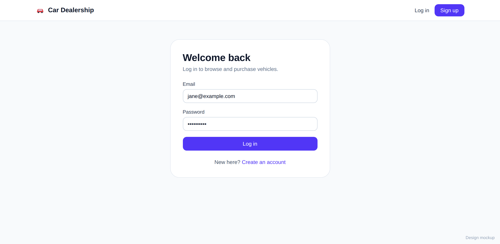
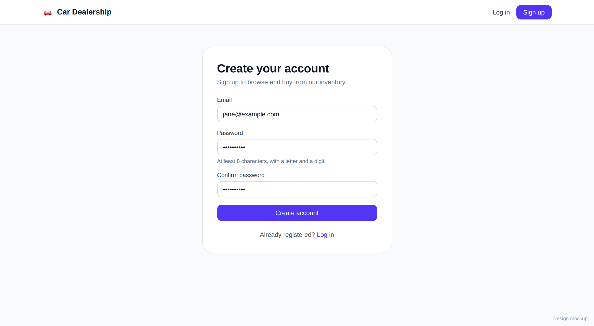
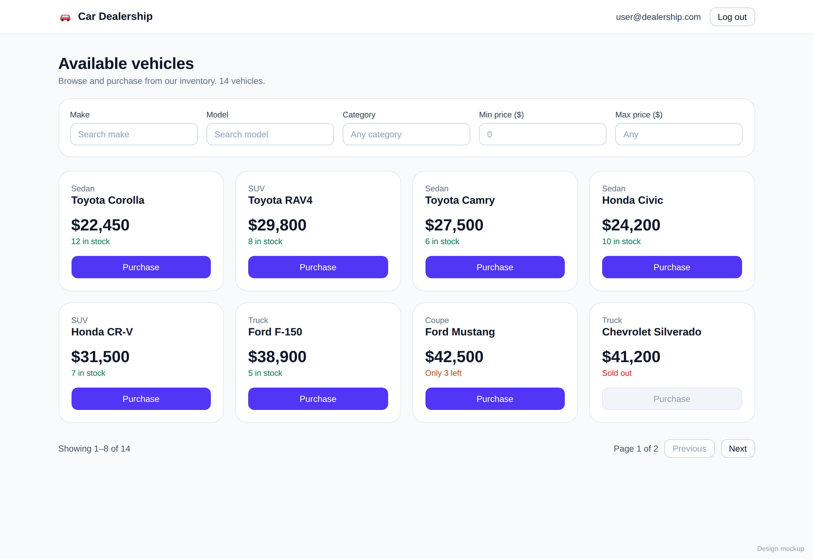
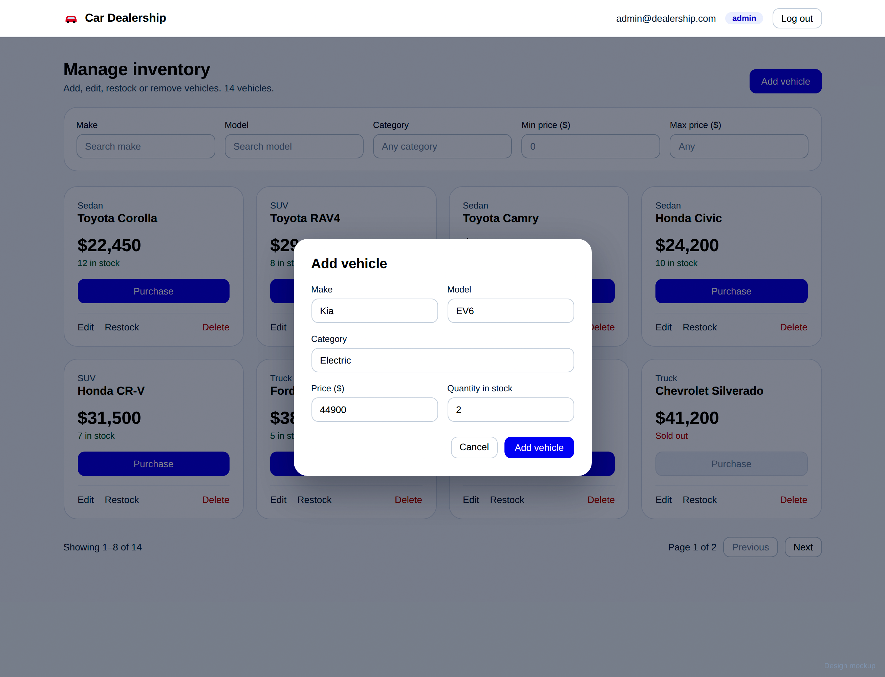

# Car Dealership Inventory System

Full-stack dealership inventory: customers browse, search and buy vehicles; admins add, edit, delete and restock them.

Deployed it on render just the frontend and am working on backend connection


## Screenshots

### Login Page


### Register Page


### User Dashboard


### Admin Dashboard


## Stack

## 🛠️ Tech Stack

| Layer | Technologies |
|-------|--------------|
| **Backend** | FastAPI · PostgreSQL · SQLAlchemy 2 · Alembic · JWT Authentication |
| **Frontend** | React · TypeScript · Vite · Tailwind CSS · TanStack Query |
| **Testing** | pytest · Vitest |
| **DevOps & CI/CD** | Docker Compose · GitHub Actions |

## Run locally

```bash
docker compose up --build -d      # PostgreSQL + API on :8000 (migrates and seeds on start)
cd frontend && cp .env.example .env && npm install && npm run dev   # app on :5173
```

Backend only: `cd backend && pip install -r requirements-dev.txt && alembic upgrade head && python -m app.seed && uvicorn app.main:app --reload`

| Role | Email | Password |
|---|---|---|
| Admin | admin@dealership.com | Admin#12345 |
| User | user@dealership.com | Shopper#12345 |

Key settings (see `backend/.env.example`): `DATABASE_URL`, `JWT_SECRET` (must be set in production), `CORS_ORIGINS`, `SEED_ON_STARTUP`, `VITE_API_URL`.

## API

Interactive docs at `/docs`.

| Endpoint | Access |
|---|---|
| `POST /api/auth/register`, `POST /api/auth/login`, `GET /api/auth/me` | public / user |
| `GET /api/vehicles`, `GET /api/vehicles/search`, `GET /api/vehicles/{id}` | user |
| `POST /api/vehicles/{id}/purchase` | user |
| `POST /api/vehicles`, `PUT /api/vehicles/{id}`, `DELETE /api/vehicles/{id}`, `POST /api/vehicles/{id}/restock` | admin |

## Design decisions

- **Layers:** router → service → repository.
- **No overselling:** purchase is one atomic `UPDATE ... WHERE quantity >= 1`. A test runs 10 simultaneous buyers against 3 cars and asserts exactly 3 succeed.
- **Admins cannot self-register:** the `role` field is ignored on registration; admins come from the seed script.
- **Role comes from the database,** not the token, so demotions apply immediately.
- **Login errors are identical** for unknown emails and wrong passwords.
- **Rate limits** on login, register and purchase (per IP, in memory).
- **Create/update are admin-only,** matching the kata's admin forms.
- **Token in `localStorage`:** simple, but readable by XSS; httpOnly cookies are the alternative.

## Testing

Tests were written first; the history shows red/green pairs.

```bash
cd backend && pytest --cov=app --cov-report=term-missing
cd frontend && npm test && npm run coverage
```

**Results:*
CI (ruff, pytest against Postgres, frontend lint/test/build) runs on every push.


## My AI Usage

**Tool:** Claude (Anthropic)

### How I used AI
I used Claude as a pair-programming partner, not an autopilot. I gave it the kata and asked for:
- A **delivery plan** and a **test-first commit plan** (red → green → refactor)
- **Draft tests and implementations** for each step
- **Boilerplate** for Docker, Alembic migrations, CI, and the React project structure
- **Explanations of design trade-offs**, such as why stock updates must be **atomic** (to prevent overselling under concurrent requests) and why **login errors are identical** for unknown user vs. wrong password (to prevent user enumeration)

### What I did myself
**Engineering and ownership**
- Built the repo incrementally, running every command and preserving the **red → green → commit** history so each commit is a verified, working step
- Implemented and refined the **REST API endpoints**
- Made the **architecture and scope decisions**: chose FastAPI + PostgreSQL, selected which extras to include, and designed the **admin-only create/update** permission model

**Verification and debugging**
I treated AI output as untrusted until it ran. Every snippet was executed, and when it failed I diagnosed the issue and fed the real error back:

| Problem | Root cause / fix |
|---|---|
| `StrEnum` import failure | Python 3.10 compatibility, since `StrEnum` needs 3.11+ |
| Ruff `B008` / `B904` failing CI | Lint rules on FastAPI `Depends` defaults and exception chaining |
| `CORSMiddleware` duplicate-argument error | Misconfigured middleware setup |
| Rate-limit tests never returning `429` | Test setup not triggering the limiter correctly |
| Tests failing to run | `pytest` executed from the wrong directory |

**Quality gates**
- Brought the **backend test suite and CI pipeline to green**
- Manually tested the running API in **Swagger UI**, validating real behavior:
  - `403` when a normal user hits an admin-only route
  - `409` when purchasing a sold-out car
  - `429` after repeated failed login attempts

### Takeaway
AI sped up scaffolding and drafting, while I owned the design decisions, debugging, and verification.
